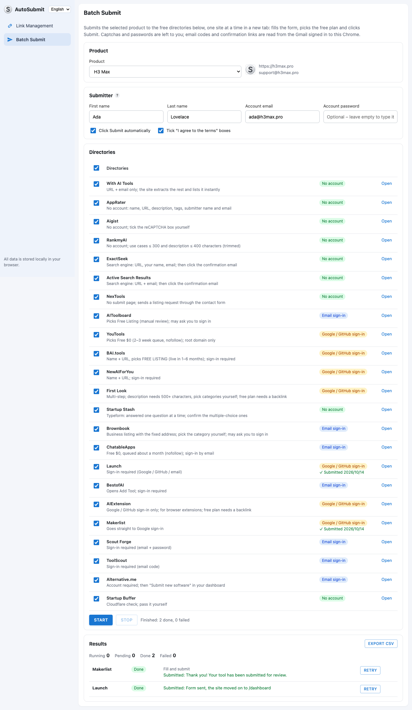

<p align="center"></p>

<h1 align="center">AutoSubmit</h1>

<p align="center">
  Submit your product to free directories without required reciprocal links or badges.<br>
  A Chrome / Edge extension that opens each directory, fills its form, picks the free plan and clicks Submit.<br>
  <b>Local only</b>: no account, no backend, no tracking.
</p>

<p align="center"><a href="#中文说明">中文说明</a></p>

---



## How it works

The directories are hard-coded in [`src/sites.js`](src/sites.js): every site's submission flow is a little different (sign-in walls, free-plan pickers, multi-step forms, Typeform), so each entry describes only what differs from the generic flow:

1. Open the site's submit page. Sites that submit on their own share one tab, and each successful site is replaced by the next. Sites that stop before Submit open a separate tab and leave it open.
2. Find the submission form (the one asking for a URL) and fill it from your product: name, URL, email, tagline / short description, description, use cases, features, pricing model, tags / category, logo and hero image; "Your name" fields get the submitter.
3. Tick "I agree to the terms", pick the free plan, check the browser's own validation (required fields, minimum length…).
4. Click Submit and watch for the result: a confirmation message, a redirect, or an error to show you.
5. Mark the site as submitted on the product. A shared automatic tab stays open for the next site; a tab that was waiting for you closes after the receipt.

What it leaves to you, polling every 5 seconds for up to 3 minutes before skipping the site:

- **Captchas**: reCAPTCHA, hCaptcha, Cloudflare Turnstile and Cloudflare's full-page check. Submit is clicked for you once it's solved.
- **Sign-in**: Google / GitHub sign-in, and any password you haven't saved. With an account password set on the batch page, email + password sign-in and sign-up are filled for you.
- **Questions it can't answer**: multiple-choice Typeform questions, custom category pickers.

Email codes and confirmation / magic links are read from the Gmail signed in to the same Chrome (forward the submission email there), including Spam and Trash. The recipient, site identity and request time must match. Unrelated or stale messages are never used; links must belong to the directory or an explicitly recorded authentication host. Saved credentials support email-then-password login; an incorrect password stops the flow without creating another account.

Each product can have backup names, one per line in preferred order. The extension tries one only after an explicit name-conflict response, preserves the original product name, and records the actual submitted name and attempted names in JSON/CSV. URL duplicates, other validation errors and missing receipts never trigger a rename.

The catalog contains page-flow configurations with different verification levels. Flows whose free eligibility still needs checking stop after filling; unsupported product pricing, CAPTCHA and missing owner-provided material also stop automatic submission. See [verification details](docs/supported-sites.md).

## Directories

Only free submissions without required reciprocal links or badges are included. The runner stops on paid buttons, selected paid listing plans, and required backlink fields. TinyLaunchpad fills the form but leaves final submission to you. Published free queues over 100 days are excluded (including BAI.tools and 10015); unknown queues are labelled. See the [2026-11-03 directory review](docs/directory-review-2026-11-03.md) for all 32 requested domains, exclusions, and verification limits.

| Site | Account | Notes |
| --- | --- | --- |
| Forward Future | – | Free public form for tool details, pricing, audience and directory tags. Review the prefilled audience and tags, then click Submit for review. The live form returned an editorial review receipt. |
| AI Valley | – | Public Contact Form7: real name, email, tool name/URL; optional long/short description share one field name and are mapped by label. Live send returned an explicit error; no receipt, queue unknown. Fill and pause pending site repair; do not retry automatically. |
| AI Tools Network | – | Basic listing is Free and uses the waiting-list form: subject, email, website, name and message. Pro $400/year and Pro Plus $550/year are Stripe checkouts and are never opened. Image captcha asks for the car; honeypot stays empty. Fill and pause. Queue unknown. |
| code.market | – | Digest form: URL, name up to 5 words, description up to 15 existing words, SaaS selected, Twitter left empty. The separate $9 week-rank control is not clicked. Fill and pause. Queue unknown; not submitted. |
| Free AI Tools Directory | – | Gravity Form: tool name, URL, description and short description. Image left empty. No payment or backlink field. Visible reCAPTCHA is not solved. Fill and pause. Queue unknown. |
| Guide of AI Tool | – | Free listing, reviewed within 48 hours. Fills name, email, tool name and URL. PayPal email is required only as a reference and is left blank. Fill and pause. |
| Insidr.ai | – | Directory form: tool name, website, AI Video Tools, Free trial, description, name and email. The off-screen honeypot stays empty. Advertise is not opened. Fill and pause. Queue unknown. |
| 设计狮 | – | Public Tencent survey linked from 设计狮 “申请收录”: URL, recommendation reason and email. No payment or reciprocal-link control. The page asks for design sites with industry recognition, so the plugin fills and pauses. Queue unknown; not submitted. |
| AI未来百科 | – | Visible 申请入驻 form: site name, URL, icon, description and AI视频工具. Login (email/password or WeChat/Weibo/QQ) and an icon are required. No payment or reciprocal control on the public form; post-login terms are unverified. Fill and pause. Do not register or submit automatically. |
| AI Top Hub | – | SUBMIT TOOL → wait for modal → real first/last name,email,tool name/URL/category → Regular within30days-free → Submit Tool. Original description and Free Trial note in additional info, optional video blank. Require thank-you receipt. |
| TinyLaunch | Email | Email verification → maker profile → startup draft → earliest free slot <=100 days → Standard Free, both extras None $0 → Continue with free launch. Require Launch Scheduled; no badge or backlink reward claimed. |
| Submit Your AI Tool | – | Free, no backlink; queue unknown. Opens the observed Fillout form. Requires email and a JPEG hero <=1 MB; wait for Upload complete. PNG is rejected. |
| AIAI.Tools | – | Free observed flow; queue unknown. Explicitly choose No backlink. Requires a public PNG/JPG screenshot URL. Done! is an intermediate page: click Submit again and require Form submitted. |
| The AI Navigator | – | Free submission verified live; queue unknown. Actively tick Privacy Policy; optional social and affiliate fields stay empty. |
| SonicRun | – | Free listing after 30 days, not guaranteed. Submission creates a free FreeWebMonitoring account. Read the verification link from Gmail, then click Add Your Site only; ignore Buy Now and Upgrade. |
| AI Siteleri | – | Free suggestion verified live; queue unknown. Requires real first/last names. Never accept the email-domain correction suggestion. |
| AI News Hub | – | FAQ confirms free basic listing, 14–21 business days, max 2/month. A cleared form is not a receipt; an uncertain attempt is not retried automatically. Ignore newsletter popup. |
| iForAI | – | Ordinary submission with optional donation for priority, no required backlink. Video Editing category; leave WeChat blank. Wait for the user to enter image CAPTCHA; no live receipt yet. |
| AI工具阁 | – | Website form mapped; article submission explicitly free, website pricing not separately stated. Fill and stop for review; a submit click opens a slider CAPTCHA. Do not infer website eligibility from article wording. |
| 外贸百科 | – | Website form only; AI Video category and 50-character summary. No payment/backlink controls seen; review eligibility and complete CAPTCHA manually before submission. Not live-submitted. |
| Aier | – | Form mapped with controlled pricing/category/profession pickers. Free Trial is absent, so RTFV pauses without substituting another model. No real receipt. |
| ToolTrove (AnyFP) | – | Free listing; badge only enables a followed link. Three steps; 60+ words, 3+ features, audience/problem and 2+ real screenshots required. Next is not a submission. Free Trial absent: pause, never substitute Paid. |
| SaaSHub | – | Free queue 1–12 weeks. URL check, 3+ categories and relevant competitor, then Free only. Explicit name conflicts use configured backup names; RTFV backup succeeded live. Paid buttons never clicked. |
| A1 Gallery | Email | Free review in 3–4 weeks; no backlink. Email magic-link login also subscribes to weekly email, so the plugin fills the email and waits for your consent click. Submit only the website URL; creator attribution is optional. |
| AIGCLIST | Email | Free nofollow review; badge optional. Sign in, check URL, write details (long description ≥400 chars), save draft, then choose Free $0. Optional product pricing left blank; actual pricing in reviewer notes. |
| Waild World | – | Free live submission, no backlink. Receipt estimates 3 days. Submitting accepts terms; product pricing is separate from submission cost. |
| AI Marketing Directory | – | Free Tally submission, no backlink; queue unknown. Open the observed embed as a full page. Page 2 says Form submitted and only offers optional paid fast-track. |
| WebCatalog | Email | Free app recommendation. Email OTP login; forwarded code read from Gmail. No developer ownership claim is made. Queue unknown. |
| AI Tools for Marketers | – | Free standard queue 2–3 weeks, badge optional. Replaces the default fast-track request. Marketing answers use product description, use cases and up to 3 tags; review for fit. |
| AI Tools Inc | – | Free queue 30–90 days. Three questions: tool name, URL, then required first/last name and email. Live receipt verified. |
| Best AI Tools | – | Free suggestion form, no reciprocal link. Requires real first/last name; leave both honeypots empty. Queue not quantified. Live receipt verified. |
| 映技派 | – | Free, no backlink; usually reviewed within 24h. Search for an existing listing before the final manual click. Live text receipt verified; screenshot was after its 5s redirect. |
| Launching Next | – | Free ordinary submission; queue unknown. Fill the quick human check yourself; optional funding/budget/newsletter remain untouched. Skip the optional $99 upgrade. |
| Future Tools | – | Free form; queue unknown. Product pricing is independent of submission cost. Complete CAPTCHA yourself. |
| AI Tools Library | – | Free ordinary submission, no backlink. Queue unknown; live receipt verified. |
| ReviewAI | – | Free, no backlink; queue unknown. Live receipt verified. |
| Human or Not | – | Free; URL and email only; publication within 48 hours. Live receipt verified. |
| TheToolBus | – | Free Directory listing; Sponsored is excluded. Review in a few days. Product pricing is independent of listing fees. |
| Jayde | – | Free, instant listing. Submitting accepts Jayde terms; controlled by the Agree to terms setting. |
| KI-Suche | – | Free; category required, description ≤600 characters; queue unknown. Live receipt verified. |
| AI工具网 | – | Free submission, optional backlink. Queue unknown; live attempt has no confirmed receipt yet. |
| With AI Tools | – | Free URL-only extraction. Already listed stops for deduplication, not a new receipt. Verify the public website link; site-generated pricing may be inaccurate. |
| AppRater | – | No account: name, URL, description, tags, submitter name and email |
| Aigist | – | Free manual review, usually5 business days. Exact Free Trial checkbox supported; no visibility email opt-in. Wait for reCAPTCHA; live submission skipped as requested. |
| RankmyAI | – | Free; dedicated website and significant AI component required. Legal company/developer identity is a separate confirmed product field, never the brand or contact by inference. Optional corporate facts/API/MCP/socials left blank. Free Trial fits free-text pricing; queue unknown. RTFV attempt cleared the form without a receipt; never retry blindly. |
| ExactSeek | – | Free URL/name/email; actively agree to terms and attached SiteProNews subscription. Email verification needed. Empty CGI header is not a receipt; uncertain attempts must not be retried. |
| Active Search Results | – | Live free receipt verified. URL + email; usually searchable in1–2hours. Official form explicitly requires no sign-in or email activation. |
| NexTools | – | Contact listing request, not guaranteed inclusion. Fill and review fee eligibility. RTFV attempt has no receipt; do not retry. Ignore incorrect email-domain suggestion. |
| AIToolboard | Email | Free Listing selected; required product pricing has no Free Trial. Image required. Review only until exact pricing is available. |
| YouTools | OAuth | Select Free $0 instead of default paid Basic; 2–3 weeks, nofollow. Google sign-in on submit was skipped by user; later Pick3 flow is an older adapter, not verified this time. |
| Startup Stash | – | Typeform now loads. It asks for name, work email, product name, short and long descriptions, URL, category and logo. Answer No to advertising; that skips the paid campaign questions and ends the listing application. The plugin pauses on that question. Not submitted. |
| Brownbook | Email | Per-product actual country required. Address and phone are optional in observed form. Step2 needs registration, terms and CAPTCHA; review only, no automatic credential entry. |
| ChatableApps | Email | Email magic link can land in Spam. Authenticated, own tools empty. Free listing about a month, but required product pricing has no Free Trial: RTFV stops. Prefer active Next over persistent Create; Next is draft. No false pricing or final submission. |
| Launch | OAuth | Five steps; icon and hero image required; Free plan launches after the paid queue (~7 days); Google sign-in |
| BestofAI | Email | Email/password account and email verification completed. /tool/add returns404 User not found, even after reload; stop for website repair, no duplicate signup. Uses configured password for ordinary login. |
| Makerlist | OAuth | Google sign-in; PNG icon under 256 KB; tags from its own list |
| Scout Forge | Email | Listing free; 3–5 business days. From My Apps click Submit new app (hard navigation can show stale auth gate). URL extraction → replace generated facts → logo/media<5MB/category review → optional socials → terms+email subscription → explicit receipt. Review-only pending full widget automation; credits/reviews/promotions separate. |
| ToolScout | Email | Email code login → main info → optional launch quiz → Standard Free $0 → exact Free Trial → mandatory human visits to5 community tools. User skipped this step; no automated traffic or final submission. Review only; final receipt unverified. |
| Alternative.me | Email | User registered, signed in, but email unverified; resend requested once and no matching mail found, including Spam. First software-name Next did not advance. Wait for verification; configured password handles ordinary login. |
| Startup Buffer | – | Basic info → Continue draft → story and completed screenshot upload<=15MB → Continue draft → country/category/tags → Submit Now. Require Your submission is in. Stop on optional paid promotion page; no package or backlink required, queue unknown. Private edit URL omitted from receipts. |
| Viesearch | – | Free ordinary listing; usually1–2 business days. URL/email required, title/description optional, category automatic. Submit accepts Terms/Privacy/Guidelines/Standards; reciprocal badge optional, not claimed. Require explicit receipt. |
| TinyLaunchpad | OAuth | Free launch, no badge. Sign in, review the launch date and Free plan, then submit manually; dofollow links only for the top 3 free launches. |

Adding a site: add an entry to `SITES` in `src/sites.js` (selectors for the form, free plan text, extra fields, special steps), then run it once with **Click Submit automatically** off to check the fill.

The [submission progress checklist](docs/submission-progress.md) covers all 235 unique domains from both user lists, with separate checks for completed review and confirmed submission. Run `npm run directories` after each batch to update it from the audit. The [submission protocols](docs/submission-protocols-2026-11-03.md) retain field details and blockers. Import [rtfv-product.json](rtfv-product.json) to retain confirmed submissions and avoid selecting them again. Attempts without a receipt are also unticked by default. CSV exports include transport, observed method/action, queue and terms metadata.

## Install

1. Download the latest `autosubmit-vX.Y.Z.zip` from [**Releases**](https://github.com/junwei000/autosubmit-extension/releases/latest) and unzip it. (Or clone this repository.)
2. Open `chrome://extensions` (or `edge://extensions`) and turn on **Developer mode**.
3. Click **Load unpacked** and select the project folder (the one that contains `manifest.json`).
4. Click the toolbar icon to open **Batch Submit**.

## Usage

1. **Link Management**: add your product (name, URL, email, tagline, description, use cases, features, pricing, tags, logo, hero image). **Add from website** reads all of that from the product's own homepage (name, description, logo, contact address), so a new product takes one paste instead of a dozen fields. Import / Export JSON moves products between browsers.
2. **Batch Submit**: pick the product, fill in the submitter (name, account email; the password is optional), tick the directories (ones already submitted for this product start unticked) and click **Start**.
3. Follow the results table. Rows that need you turn amber; **Show tab** takes you there. Each row can be marked done / failed or retried; **Export CSV** saves the table.

## Privacy

Products, the submitter and results live in `chrome.storage.local` on your machine. The extension sends your product details only to the directories you start a run for, and reads Gmail only to find a code or confirmation link for the site being processed. Permissions: `storage`, `unlimitedStorage` (images), `alarms` (stalled-site watchdog), `scripting` + `mail.google.com` (reading codes from Gmail).

## Development

```
manifest.json        MV3 manifest
src/sites.js         directory list and per-site differences
src/engine.js        form field detection + autofill (content script)
src/runner.js        batch steps on the directory's page: sign-in, codes, fill, free plan, submit, result (content script)
src/background.js    queue: shared tab for automatic sites, a kept tab when a person must finish, watchdog, Gmail lookups
src/batch.*          Batch Submit page (toolbar icon)
src/manage.*         Link Management page (options page)
src/store.js         chrome.storage.local helpers
src/i18n.js          en / zh strings
icons/logo.svg       source logo (PNG icons: npm run icons)
test/                Playwright end-to-end test + fixture forms
```

No build step: edit the files, then click **Reload** on `chrome://extensions`.

```bash
npm install          # playwright (only needed for tests/icons)
npm run directories  # regenerate supported-site documentation from the catalog
npm test             # loads the unpacked extension and runs the queue against test/fixture*.html
npm run icons        # re-render icons/*.png from icons/logo.svg
npm run zip          # build dist/autosubmit-v<version>.zip (same as CI)
```

The tests cover the queue against three fixture directories, the new adapters on a local HTTP server, free-plan/payment/backlink guards, and the sign-up flow: the fixture asks for a code, the plugin reads it from a stand-in inbox and writes it back before submitting.

### Releasing

The [Release workflow](.github/workflows/release.yml) builds the zip and publishes a GitHub Release:

1. Bump `"version"` in `manifest.json` and merge to `main`.
2. Push a matching tag (`git tag v2.0.0 && git push origin v2.0.0`), **or** open *Actions → Release → Run workflow* and the tag `v<version>` is created for you.

## License

[MIT](LICENSE)

---

## 中文说明

**AutoSubmit** 是一个浏览器插件，把你的产品批量提交到免费的 AI 导航站：按顺序逐站打开提交页，自动填表、选免费方案、点提交，再判断结果。所有数据保存在本地浏览器里，没有后端。

### 流程

站点写死在 `src/sites.js` 里，每站只写和通用流程不一样的地方（登录墙、免费方案、分步表单、Typeform 等）。通用流程：

1. 打开站点的提交页。能自动提交的站共用一个标签页，成功后在同一页打开下一个站。需要提交前人工处理的站各自新开标签页，并留在那里
2. 找到提交表单（要求填网址的那个），按产品资料填写：名称、网址、邮箱、一句话介绍 / 简短描述、描述、使用场景、核心功能、收费模式、标签 / 分类、Logo 和主图；「Your name」等字段填提交人
3. 勾选同意条款、选免费方案，检查浏览器自带的校验（必填、最少字数等）
4. 自动点提交并识别结果：成功提示、页面跳转，或者把报错告诉你
5. 在产品上记为已提交。自动提交共用的标签页留给下一个站；等你点过提交并出现回执的页面再关闭

需要你处理的情况（每 5 秒检查一次，最多等 3 分钟，超时跳过该站）：

- **人机验证**：reCAPTCHA、hCaptcha、Cloudflare Turnstile 和 Cloudflare 整页验证，你完成后插件自动点提交
- **登录**：Google / GitHub 登录，以及没保存的密码。批量提交页填了账号密码时，邮箱 + 密码的登录和注册由插件自动填写
- **插件答不了的问题**：Typeform 的选择题、自定义的分类下拉

邮箱验证码和确认 / 登录链接从同一个 Chrome 登录的 Gmail 里读取（提交用的邮箱要转发到这个 Gmail），包括垃圾邮件和垃圾箱：限定账号邮箱、站点身份及本次请求之后收到的邮件。普通登录读取本地配置密码，支持先邮箱后密码的两步登录；密码错误时停止，不重复注册。

产品可填写重名备用名称，每行一个、按优先顺序使用。只有收到明确的名称重复错误才切换；原产品名称保持不变，JSON/CSV记录实际投稿名和尝试过的名称。网址重复、普通报错和回执未知不会触发改名重投。

配置数量不代表全部都能自动完成。免费条件待核实的流程只填表后停下；没有准确的产品定价选项、需要验证码或缺少本人提供的素材时也会暂停。各站验证范围见[支持站点与流程](docs/supported-sites.md)。

### 站点

只纳入免费且不强制互链 / 挂徽章的提交渠道。遇到付费按钮、已选付费收录方案或必填反链字段时停止自动提交。TinyLaunchpad 填写后需要手动确认最终提交。公开队列超过 100 天的 BAI.tools、10015 已从可选目录排除；未知排期单独标注。32 个域名的处理结果、排除原因及验证限制见[站点核对记录](docs/directory-review-2026-11-03.md)。

| 站点 | 账号 | 说明 |
| --- | --- | --- |
| Forward Future | 免登录 | 免费公开表单，填写产品资料、实际定价、受众和标签。请检查自动填写的受众与标签，再点击提交审核。实测已取得编辑审核回执。 |
| AI Valley | 免登录 | 公开Contact Form7：真实姓名/邮箱/工具名称网址；长短描述同名，按可见标签分别填。真实发送返回错误，无回执，排期未知。暂只填表检查，等待站点修复，不自动重试。 |
| AI Tools Network | 免登录 | Basic 明确免费，走等候名单表单：主题、邮箱、网址、姓名和说明。Pro 每年 400 美元、Pro Plus 每年 550 美元是 Stripe 结账，不会打开。图形验证码要求选出汽车，蜜罐保持空白。只填表并暂停，排期未知。 |
| code.market | 免登录 | 摘要表单填写网址、最多5个词的名称、最多15个词的现有说明，并选择SaaS，Twitter留空。旁边9美元的周排名不会点击。只填表并暂停，排期未知，未投稿。 |
| Free AI Tools Directory | 免登录 | Gravity Form：工具名、网址、介绍和短说明。图片留空。没有收费或互链字段。可见的 reCAPTCHA 不代答。只填表并暂停，排期未知。 |
| Guide of AI Tool | 免登录 | FAQ写明投稿完全免费，48小时内审核，不接受付费上榜。填写姓名、邮箱、工具名和网址。PayPal邮箱只作投稿参考，没有现成地址所以留空。只填表并暂停。 |
| Insidr.ai | 免登录 | 目录表单填写工具名、网址、AI Video Tools、Free trial、介绍、姓名和邮箱。屏幕外的蜜罐保持空白。不打开 Advertise。只填表并暂停，排期未知。 |
| 设计狮 | 免登录 | 设计狮“申请收录”腾讯问卷：网址、推荐理由、邮箱。未见收费或互链控件。页面要求设计类站点并需行业知名度，因此只填表并暂停。排期未知，未投稿。 |
| AI未来百科 | 免登录 | 申请入驻表单可见：网站名称、网址、图标、介绍，分类选AI视频工具。必须先登录（邮箱密码或微信/微博/QQ），且必须上传图标。公开表单没有收费或互链控件，登录后的条件未核实。只填表并暂停，不自动注册或提交。 |
| AI Top Hub | 免登录 | SUBMIT TOOL→等待弹窗→真实姓名/邮箱/工具名称网址分类→30天内免费Regular→Submit Tool。附加信息写原描述和Free Trial，视频可留空；仅明确感谢页算成功。 |
| TinyLaunch | 邮箱 | 邮箱验证→投稿人资料→产品草稿→100天内最早免费档期→Standard Free、两项附加服务None $0→跳过升级。仅Launch Scheduled算回执；不加徽章，不声称获得外链奖励。 |
| Submit Your AI Tool | 免登录 | 免费无互链，排期未知；打开实测Fillout表单。须完整加载邮箱字段、上传≤1MB的JPEG主图并等Upload complete；PNG会被拒绝。 |
| AIAI.Tools | 免登录 | 实测无收费，排期未知；互链明确选No。需公开PNG/JPG截图网址；Done!仍为中间页，须再点Submit并取得Form submitted回执。 |
| The AI Navigator | 免登录 | 实测投稿无收费或互链；排期未知。主动勾选隐私协议，社交账号和联盟链接留空。 |
| SonicRun | 免登录 | 免费30天收录、不保证通过；附带FreeWebMonitoring免费账户。Gmail读取验证链接后，只勾选免费表单并点Add Your Site，忽略两项收费升级。 |
| AI Siteleri | 免登录 | 实测建议表单无收费或互链，排期未知；需真实名/姓。不接受网站建议的邮箱域名替换。 |
| AI News Hub | 免登录 | FAQ确认免费基础收录、14–21工作日、每月最多2次。表单清空不算回执，未确认尝试不自动重投；关闭订阅弹窗。 |
| iForAI | 免登录 | 普通投稿、优先审核打赏可选，无强制互链；视频剪辑分类，微信留空。等待人工图形验证码，本轮按用户要求跳过实投，无回执。 |
| AI工具阁 | 免登录 | 网址字段已适配；页面明确免费的是文章投稿，网址费用未单独说明。填好后暂停核实免费条件，不自动提交；点击会弹滑块，不能把文章免费当网址免费证据。 |
| 外贸百科 | 免登录 | 仅操作网站表单；AI视频分类，简介上限50字符。当前无费用/互链控件，最终免费条件和图形验证码需人工检查后提交；本轮未实投。 |
| Aier | 免登录 | 已适配定价、分类和职业受控下拉框；没有Free Trial，RTFV停在定价校验，不改选其他模式。当前表单无收费/互链项，无真实回执。 |
| ToolTrove (AnyFP) | 免登录 | 免费收录，徽章仅用于dofollow。三步；至少60词、3项功能、用途/问题及2张真实截图，Next不算提交。没有Free Trial时暂停，不改选Paid。 |
| SaaSHub | 免登录 | 免费队列1–12周。网址检查→至少3个分类及相关竞品→仅点Free。明确重名才使用备用名称，本次以RTFV成功；不点$75/$99。 |
| A1 Gallery | 邮箱 | 免费审核3–4周，无互链。邮箱登录附带每周订阅，插件填邮箱后等待本人确认点击，再从Gmail读取登录链接；仅提交网址，额外创作者选填。 |
| AIGCLIST | 邮箱 | 免费nofollow审核，徽章可选。登录→网址查重→手工详情（长描述至少400字符）→保存草稿→Free $0。可选定价不操作，真实产品收费模式写审核备注；排期上限未知。 |
| Waild World | 免登录 | 实测提交免费、无互链；回执预计3天。提交即接受条款，产品定价与投稿费用分开。 |
| AI Marketing Directory | 免登录 | Tally实测投稿免费、无互链，排期未知；直接打开已观察到的问卷页面。第2页已显示提交成功，仅附可选付费加速，不点击。 |
| WebCatalog | 邮箱 | 免费应用推荐；使用邮箱验证码登录，从转发到Gmail的邮件读取验证码。仅填写名称和网址，不代做开发者归属认证；排期未知。 |
| AI Tools for Marketers | 免登录 | 免费普通队列约2–3周，徽章可选；主动取消默认加速推广。营销问题使用产品描述、用途和最多3个标签，需符合营销场景。 |
| AI Tools Inc | 免登录 | 免费队列 30–90 天；三题：工具名、网址、联系人名/姓/邮箱。姓名缺失时等待补齐；已实测收到回执。 |
| Best AI Tools | 免登录 | 实测建议表单免费、无互链；需要真实名/姓，两个诱捕字段留空。审核约几天，上限未知；已有回执。 |
| 映技派 | 免登录 | 实测免费、无互链，一般24小时审核；先站内查重，再人工最终点击。已读到“操作成功”，截图为5秒跳转后页面。 |
| Launching Next | 免登录 | 普通提交免费、排期未知；手动填写人机校验后继续，融资/预算/订阅不代填；不购买后续 $99 加速。 |
| Future Tools | 免登录 | 免费投稿表单，排期未知；产品定价与投稿费用分开。实测被验证码拦截，需手动完成。 |
| AI Tools Library | 免登录 | 普通投稿实测免费、无需互链；排期未知。已收到审核回执。 |
| ReviewAI | 免登录 | 免费、无需互链；排期未知。已实测收到审核回执。 |
| Human or Not | 免登录 | 免费，仅网址和邮箱；标明 48 小时内发布。已实测收到审核回执。 |
| TheToolBus | 免登录 | 选择免费 Directory listing，排除 Sponsored；审核约几天。产品定价与收录费用分开。 |
| Jayde | 免登录 | 免费即时收录；提交即接受 Jayde 条款，受“自动勾选同意条款”设置控制。 |
| KI-Suche | 免登录 | 免费，分类必选、描述最多 600 字；排期未知。已实测收到审核回执。 |
| AI工具网 | 免登录 | 免费提交，互链可选；排期未知。实测已点击，尚无明确回执，不应重复提交 RTFV。 |
| With AI Tools | 免登录 | 免费URL自动提取。Already listed按已有去重，不算新回执；核对公开页面官网链接。站点生成的定价可能不准确。 |
| AppRater | 免登录 | 免登录：App 名称、网址、介绍、标签、提交人姓名和邮箱 |
| Aigist | 免登录 | 免费人工审核，通常5工作日；支持精确Free Trial，不勾选增值邮件。等待人工reCAPTCHA，本批按要求跳过实投。 |
| RankmyAI | 免登录 | 官方明确免费，需独立网址和主要AI功能。合法公司/开发者身份须单独确认，不从产品品牌或联系人推断；未知公司资料/API/MCP/社交留空。Free Trial可写自由文本定价；排期未知。RTFV已尝试但清空表单后无回执，不盲目重投。 |
| ExactSeek | 免登录 | 免费网址/姓名/邮箱；主动同意条款及附带SiteProNews订阅，需要邮件验证。空白CGI页头不算回执，未确认尝试不重投。 |
| Active Search Results | 免登录 | 已实测免费回执；网址+邮箱，通常1–2小时可搜索。官网明确无需登录或邮件激活，插件不再等待不存在的确认邮件。 |
| NexTools | 免登录 | 联系表单收录申请，不保证收录；先填表核实免费资格。RTFV已尝试但无回执，不重投；忽略错误邮箱域名建议。 |
| AIToolboard | 邮箱 | 可选Free Listing，但必填产品定价无Free Trial；必需工具图片，默认填表后暂停检查。 |
| YouTools | OAuth | 从默认付费Basic切换Free $0（2–3周、nofollow）；提交弹Google登录，用户选择跳过。后续Pick3为旧配置，本轮未验证。 |
| Startup Stash | 免登录 | 问卷现在可以打开。要姓名、工作邮箱、产品名、短描述、长描述、网址、分类和 Logo。广告问题必须答 No，才会跳过付费投放和预算题并结束收录申请。插件停在这一题，未投稿。 |
| Brownbook | 邮箱 | 使用每个产品的真实经营国家；本轮地址电话可选。第二步需注册、条款和验证码，默认暂停检查，不自动录入新密码。 |
| ChatableApps | 邮箱 | 邮箱magic link可能进垃圾邮件；已登录、本人工具清单为空。免费收录约一个月，但产品定价必填且无Free Trial，RTFV停止。优先Next而非始终显示的Create；Next只算草稿，不误填定价或最终投稿。 |
| Launch | OAuth | 五步向导；图标和 Hero 图必传；Free 排在付费之后（约 7 天上线）；Google 登录 |
| BestofAI | 邮箱 | 邮箱账号及验证已完成；/tool/add刷新后仍404 User not found，需网站修复，不重复注册。普通登录仍读取配置密码自动提交。 |
| Makerlist | OAuth | Google 登录；图标只收 256KB 以内的 PNG；标签只能用它列表里的词 |
| Scout Forge | 邮箱 | 免费收录，3–5工作日。从My Apps内点Submit new app，直接网址可能误报未登录。网址提取→恢复真实资料→检查Logo/小于5MB媒体/分类→社交可留空→条款及订阅→明确回执。复杂控件暂保留人工检查；不消费积分或购买评测推广。 |
| ToolScout | 邮箱 | 邮箱验证码登录→基本资料→可跳过推广问卷→Standard Free $0→精确Free Trial→强制人工浏览5个社区工具。用户选择跳过；不自动互访，也未最终提交，保持人工检查。 |
| Alternative.me | 邮箱 | 用户已注册登录，但邮箱未验证；已请求一次重发，含垃圾邮件仍未找到确认信。投稿名称Next无进展，等待验证；普通登录读取配置密码。 |
| Startup Buffer | 免登录 | 基本资料→Continue草稿→介绍及截图上传完成（≤15MB）→Continue草稿→国家/分类/标签→Submit Now。仅Your submission is in算回执；付费推广可跳过、无强制互链、排期未知；不导出私密编辑链接。 |
| Viesearch | 免登录 | 普通收录免费，通常1–2工作日；网址邮箱必填，分类留空自动分配。提交接受条款/隐私/投稿规范/社区标准；互链仅额外认证，不申领。必须有明确回执。 |
| TinyLaunchpad | OAuth | 免费发布，不需徽章。登录后检查发布日期和 Free 方案，再手动提交；免费发布仅前三名获得 dofollow 链接。 |

新增站点：在 `src/sites.js` 的 `SITES` 里加一项（表单选择器、免费方案文字、额外字段、专用步骤），先关掉「自动点击提交」跑一遍检查填写结果。

[投稿总进度表](docs/submission-progress.md) 合并两张用户清单，逐站区分“核查已结项”和“投稿已确认”，每批结束后运行 `npm run directories` 同步勾选与统计。[235个域名的结构台账](docs/submission-protocols-2026-11-03.md) 保留表单、协议及阻塞原因。导入 [rtfv-product.json](rtfv-product.json) 可保留已提交记录，成功站和结果未确认的尝试默认不勾选；插件 CSV 导出包含提交方式、表单声明、排期与条款信息。所有新增适配均通过页面填写与点击完成，验证码和登录仍需人工处理。

### 安装

1. 从 [**Releases**](https://github.com/junwei000/autosubmit-extension/releases/latest) 下载最新的 `autosubmit-vX.Y.Z.zip` 并解压（也可以直接 `git clone` 本仓库）
2. 打开 `chrome://extensions`（Edge 是 `edge://extensions`），开启右上角的**开发者模式**
3. 点击**加载已解压的扩展程序**，选择包含 `manifest.json` 的目录
4. 点工具栏里的插件图标，打开「批量提交」

### 使用

1. **链接管理**：添加产品（名称、网址、邮箱、一句话介绍、描述、使用场景、核心功能、收费模式、标签、Logo、主图）。描述写长一些，能通过的站更多。支持 JSON 导入 / 导出
2. **批量提交**：选产品，填提交人（姓名、账号邮箱；密码可不填，需要时你自己输入），勾选站点（该产品已提交过的站默认不勾），点「开始提交」
3. 看结果表：需要你操作的行会变成黄色，点「切到标签页」过去处理；每行可以标记成功 / 失败或重试，「导出 CSV」保存结果

### 发布新版本

修改 `manifest.json` 里的 `version` 并合并到 `main`，然后推送同名 tag（如 `v2.0.0`），或者在 Actions → Release 里点 **Run workflow**。CI 会自动打包 zip 并发布到 Releases。
